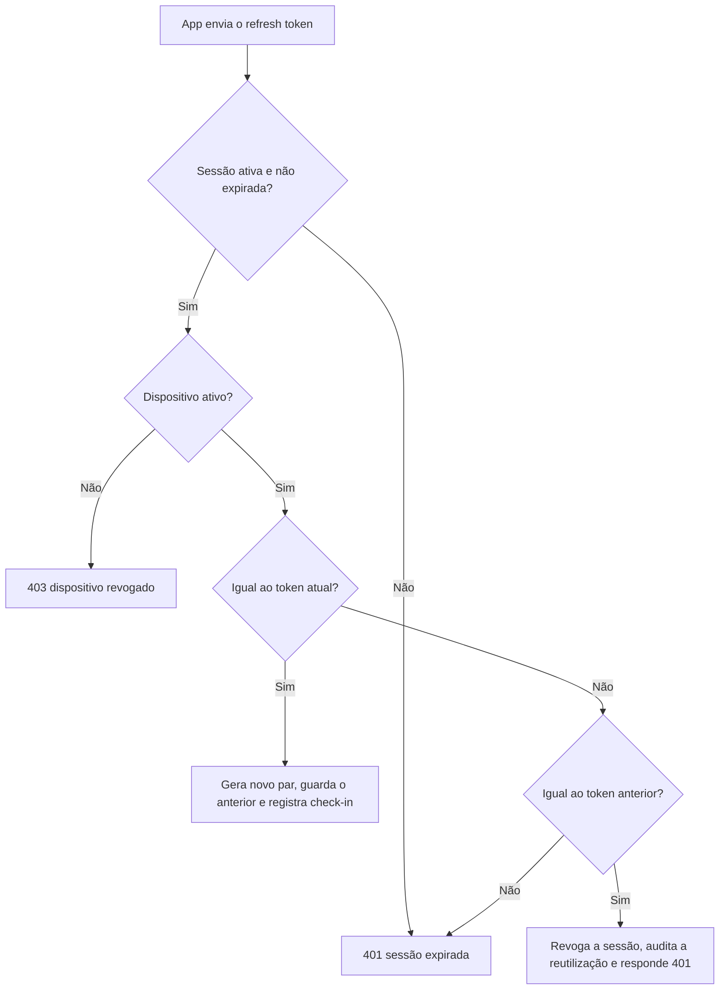
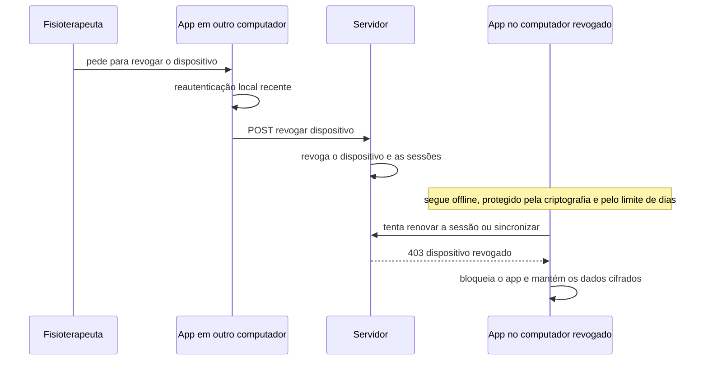

# Contexto Identidade e Acesso — Especificação para Construção

> Usuário: o fisioterapeuta (único usuário nos próximos \~2 anos). Contém só o que é preciso para construir este contexto: regras de negócio, decisões técnicas, casos de uso e as camadas domain, application e infrastructure. Valores marcados com **(assumido)** são o ponto de partida recomendado e ainda aguardam sua confirmação; todos ficam em configuração, nunca fixos no código.

---

## 1. Escopo

**Dentro:** login no servidor (e-mail, senha, MFA), dispositivos, sessões, desbloqueio local offline, permissões, recuperação de conta e auditoria de acesso.

**Fora:** dados clínicos e sua sincronização (este contexto só fornece `DispositivoId`, `UsuárioId` e a revogação), e o fluxo completo de múltiplos usuários (aqui só fica **preparado**).

**Dois mecanismos separados** (a decisão que organiza tudo):

| Mecanismo | Pergunta | Precisa de internet? | Resultado |
| --- | --- | --- | --- |
| **Login no servidor** | Quem é você para a API? | Sim | Tokens para a sincronização |
| **Desbloqueio local** | Quem pode abrir os dados deste computador? | **Não** | Chave que abre o banco local |

---

## 2. Parâmetros configuráveis

| Parâmetro | Padrão | Observação |
| --- | --- | --- |
| Inatividade até bloquear o app | 10 min **(assumido)** | Também bloqueia ao suspender o computador |
| Limite de dias offline | 5 **(assumido)** | Depois dele, só leitura |
| Leitura permitida após o limite | Sim **(assumido)** | Bloquear a leitura atrapalharia o atendimento |
| Tentativas de login antes de bloquear a conta | 5 |  |
| Bloqueio progressivo | 1, 5, 15, 60 min | Sobe a cada nova rodada de falhas |
| Máximo de dispositivos ativos | 3 **(assumido)** |  |
| Tamanho mínimo da senha | 12 | Vale para a senha de login e para a senha mestre |
| Validade do access token | 15 min |  |
| Validade do refresh token | 30 dias |  |
| Janela de reautenticação em ação sensível | 5 min |  |
| Falhas de desbloqueio local antes de exigir login completo | 10 |  |

---

## 3. Regras de negócio

### Conta

| ID | Regra | Camada |
| --- | --- | --- |
| RN-01 | **Não existe cadastro público.** O primeiro Proprietário é criado por comando administrativo no servidor; contas futuras, por convite do administrador | Application |
| RN-02 | E-mail único, comparado em minúsculas e sem espaços | Domain |
| RN-03 | Sempre existe ao menos **um Proprietário ativo**. Não é possível desativar ou rebaixar o último | Domain service |
| RN-04 | A conta **nunca é excluída**, só desativada | Domain |
| RN-05 | Senha com no mínimo 12 caracteres, diferente do e-mail, e fora de uma lista de senhas comuns | Domain service |
| RN-06 | A senha é guardada **só como hash Argon2id** e nunca aparece em log | Infra |

### MFA e recuperação

| ID | Regra | Camada |
| --- | --- | --- |
| RN-07 | **MFA obrigatório.** Sem MFA configurado não há sessão: o primeiro login passa pela configuração do TOTP | Domain |
| RN-08 | Ao configurar o MFA, geram-se **10 códigos de recuperação**, de uso único, mostrados uma vez e guardados só como hash | Domain |
| RN-09 | Usar um código de recuperação gera auditoria e orienta o usuário a regenerar os códigos | Application |
| RN-10 | Um mesmo código TOTP não pode ser usado duas vezes (guarda-se o último passo aceito) | Domain |

### Login e sessão

| ID | Regra | Camada |
| --- | --- | --- |
| RN-11 | O login tem **dois passos**: e-mail + senha, depois o código do autenticador (ou de recuperação) | Application |
| RN-12 | Erros de login são **genéricos**: não revelam se o e-mail existe | Application |
| RN-13 | 5 falhas consecutivas bloqueiam a conta com atraso progressivo; o contador zera só após um login completo | Domain |
| RN-14 | Access token de 15 min; refresh token **rotativo**. Apresentar um refresh antigo **revoga a sessão** | Domain |
| RN-15 | Toda sessão pertence a **um dispositivo ativo**. Um dispositivo tem no máximo uma sessão ativa | Domain |
| RN-16 | Trocar a senha revoga todas as outras sessões | Application |

### Dispositivo

| ID | Regra | Camada |
| --- | --- | --- |
| RN-17 | O dispositivo é registrado no primeiro login concluído (após o MFA), com apelido e plataforma | Application |
| RN-18 | No máximo 3 dispositivos ativos por usuário | Domain service |
| RN-19 | Dispositivo **revogado** não renova token nem sincroniza; ao conectar, o app é bloqueado e os dados locais continuam cifrados | Domain |
| RN-20 | Todo login, renovação e sincronização atualiza o **último check-in** do dispositivo | Application |
| RN-21 | Passado o limite de dias offline sem check-in, o app entra em **modo somente leitura** até conectar | Domain |
| RN-22 | A revogação exige reautenticação recente e registra o motivo | Application |

### Desbloqueio local

| ID | Regra | Camada |
| --- | --- | --- |
| RN-23 | O app **sempre abre bloqueado**. Os dados locais só abrem após biometria ou senha mestre | Infra (Rust) |
| RN-24 | A **senha mestre** é definida no primeiro acesso, vale só neste computador e **nunca vai ao servidor** | Infra (Rust) |
| RN-25 | A biometria é opcional, só pode ser ativada depois que a senha mestre existe, e a senha mestre **sempre** funciona | Application |
| RN-26 | Bloqueio automático por inatividade e ao suspender o computador | Infra (Rust) |
| RN-27 | Falhas de senha mestre geram atraso crescente, **persistido** (não zera ao reiniciar). Após 10 falhas, exige login completo online | Infra (Rust) |
| RN-28 | **Nunca apagar dados locais por tentativas falhas**: eles podem ter eventos ainda não sincronizados | Application |
| RN-29 | Ações sensíveis (exportar prontuários em lote, revogar dispositivo, trocar senha ou MFA, alterar senha mestre) exigem reautenticação local nos últimos 5 min | Application |

### Permissões

| ID | Regra | Camada |
| --- | --- | --- |
| RN-30 | Permissões têm o formato `contexto:ação` (ex.: `clinico:escrever`) | Domain |
| RN-31 | **Todo caso de uso de qualquer contexto** verifica a permissão pelo `ContextoDeAcesso`. O Proprietário tem todas | Application |
| RN-32 | Nenhum outro contexto consulta a Identidade; recebem apenas o `ContextoDeAcesso` | Application |

### Recuperação

| ID | Regra | Camada |
| --- | --- | --- |
| RN-33 | **Esqueceu a senha de login:** link de redefinição enviado ao e-mail, de uso único e válido por 30 min. Para concluir, exige também o código TOTP ou de recuperação | Application |
| RN-34 | **Perdeu o autenticador:** entra com um código de recuperação e reconfigura o MFA | Application |
| RN-35 | **Esqueceu a senha mestre:** só é possível redefinir o desbloqueio local descartando a cópia local e baixando tudo de novo do servidor. O app avisa antes se houver eventos pendentes, pois eles se perdem | Application |
| RN-36 | **Último recurso** (perdeu senha, autenticador e códigos): comando administrativo no servidor | Infra |

### Auditoria

| ID | Regra | Camada |
| --- | --- | --- |
| RN-37 | Registrar: login ok e falha, MFA configurado, uso de código de recuperação, dispositivo registrado e revogado, troca de senha, desbloqueio local ok e falha, reautenticação sensível | Application |
| RN-38 | Cada registro leva `UsuárioId`, `DispositivoId`, data em UTC e, no servidor, o IP. **Nunca** leva senha, código ou conteúdo clínico | Infra |
| RN-39 | Os logs são **append-only**. No app, são assinados e encadeados, e enviados ao servidor com prioridade na reconexão | Infra |

---

## 4. Decisões técnicas

| ID | Decisão | Status | Motivo |
| --- | --- | --- | --- |
| DT-01 | Implementação **própria mínima** no NestJS, atrás da porta `Autenticador` | **Assumida** | Superfície pequena (um usuário, sem cadastro público, sem login social). A porta permite trocar por provedor gerenciado depois |
| DT-02 | Hash de senha **Argon2id** no servidor | Decidida | Ponto de partida: memória 19 MiB, 2 iterações, paralelismo 1 (conferir os valores atuais da OWASP ao implementar) |
| DT-03 | **TOTP** (RFC 6238): 6 dígitos, 30 s, janela de ±1 passo, biblioteca `otplib`. O segredo é cifrado em repouso com AES-256-GCM, chave vinda do cofre de segredos do servidor | Decidida | Padrão consolidado e compatível com qualquer app autenticador |
| DT-04 | Access token **JWT** (HS256, 15 min). Refresh token **opaco** (256 bits aleatórios), guardado no servidor só como hash | Decidida | O refresh opaco é revogável e permite detectar reutilização |
| DT-05 | No app, o refresh token fica no **Keychain / Credential Manager**; o access token só em memória. Nunca em `localStorage` | Decidida | Evita roubo por script |
| DT-06 | Limite de taxa por IP com `@nestjs/throttler`; bloqueio por conta no próprio domínio | Decidida | Duas camadas de defesa |
| DT-07 | **Hierarquia de chaves local:** uma chave de dados (DEK) aleatória de 256 bits cifra banco e arquivos. Ela é "embrulhada" de dois jeitos independentes: pela chave derivada da **senha mestre** (Argon2id + AES-256-GCM) e pela chave protegida por **biometria** | Decidida | Trocar a senha mestre não recifra tudo; a biometria nunca é o único caminho |
| DT-08 | A DEK vive **só na memória do processo Rust** e é zerada ao bloquear. O React nunca vê a chave | Decidida | Código da interface não consegue vazar a chave |
| DT-09 | Argon2id do cliente com parâmetros mais fortes que os do servidor, calibrados para \~0,5 a 1 s no computador do consultório | Decidida | A senha mestre protege contra cópia do arquivo; o custo do Argon2id é a defesa real |
| DT-10 | Biometria via plugin comunitário `tauri-plugin-biometry`, atrás da porta `BiometriaLocal` | **Em validação** | O plugin oficial é só mobile. Spike obrigatório; plano B: somente senha mestre |
| DT-11 | Timer de inatividade **no Rust**; o React só envia sinais de atividade | Decidida | Impede burlar o bloqueio pela interface |
| DT-12 | Relógio injetado (porta `Relogio`) com **marca d'água**: guarda-se o maior instante já visto e, se o relógio do sistema retroceder, o app trata como modo somente leitura | Decidida | Impede burlar o limite de dias offline voltando o relógio |
| DT-13 | Auditoria local: registros **encadeados por hash** e assinados (Ed25519), chave no cofre do sistema operacional | Decidida | Detecta adulteração |
| DT-14 | Erros de domínio **tipados**, traduzidos para HTTP só na borda | Decidida | Domínio sem conhecer HTTP |
| DT-15 | Papéis definidos em código no MVP; permissões como tipo literal `contexto:ação` | Decidida | Simples agora, extensível depois |
| DT-16 | Provedor de e-mail transacional (recuperação de senha) | **Em aberto** | Falta escolher |
| DT-17 | Cofre de segredos do servidor (chave de cifra do TOTP, segredo do JWT) | **Em aberto** | Depende da hospedagem |

> **Limite honesto do desbloqueio local:** o contador de falhas não impede quem **copiou os arquivos** de tentar senhas em outra máquina. Nesse cenário, a defesa é uma senha mestre forte e o custo do Argon2id (DT-09). O contador protege contra quem tem só o aplicativo aberto.

---

## 5. Camada Domain

Pacote compartilhado `packages/domain/src/identidade-e-acesso/`, **sem dependência** de NestJS, React ou Tauri.

### 5.1 Elementos

| Tipo | Elementos |
| --- | --- |
| **Agregados** | `Usuario`, `Dispositivo`, `SessaoDeLogin` |
| **Value objects** | `UsuarioId`, `DispositivoId`, `Email`, `HashDeSenha`, `Papel`, `Permissao`, `CodigoDeRecuperacao`, `SegredoTotpCifrado`, `PoliticaDeAcesso`, `ContextoDeAcesso` |
| **Serviços de domínio** | `PoliticaDeSenha`, `PoliticaDeProprietario`, `AvaliadorDeModoOffline` |

### 5.2 Código de referência

```ts
// politica-de-acesso.ts
export interface PoliticaDeAcesso {
  readonly inatividadeMin: number;                    // 10
  readonly limiteDiasOffline: number;                 // 5
  readonly leituraPermitidaAposLimite: boolean;       // true
  readonly maxTentativasLogin: number;                // 5
  readonly bloqueioProgressivoMin: readonly number[]; // [1, 5, 15, 60]
  readonly maxDispositivosAtivos: number;             // 3
  readonly tamanhoMinimoSenha: number;                // 12
  readonly validadeAccessMin: number;                 // 15
  readonly validadeRefreshDias: number;               // 30
  readonly janelaReautenticacaoMin: number;           // 5
  readonly maxFalhasDesbloqueioLocal: number;         // 10
}
```

```ts
// permissao.ts e papel.ts
type Contexto = 'pacientes' | 'clinico' | 'agenda' | 'cobranca' | 'financeiro'
  | 'recibos' | 'contratos' | 'equipamentos' | 'comunicacao' | 'identidade';
type Acao = 'ler' | 'escrever' | 'administrar';
export type Permissao = `${Contexto}:${Acao}`;

export interface Papel {
  readonly nome: string;
  concede(p: Permissao): boolean;
}
export const PROPRIETARIO: Papel = { nome: 'proprietario', concede: () => true };
```

```ts
// contexto-de-acesso.ts  (é o que os outros contextos recebem)
export class ContextoDeAcesso {
  constructor(
    readonly usuarioId: UsuarioId,
    readonly dispositivoId: DispositivoId,
    private readonly papeis: readonly Papel[],
  ) {}
  temPermissao(p: Permissao): boolean { return this.papeis.some(r => r.concede(p)); }
  exigir(p: Permissao): void { if (!this.temPermissao(p)) throw new SemPermissao(p); }
}
```

```ts
// usuario.ts (trechos que carregam as regras)
export class Usuario {
  garantirQuePodeAutenticar(agora: Date): void {
    if (this.props.situacao === 'desativado') throw new ContaDesativada();
    if (this.props.bloqueadoAte && agora < this.props.bloqueadoAte)
      throw new ContaBloqueada(this.props.bloqueadoAte);
  }

  registrarFalhaDeLogin(agora: Date, politica: PoliticaDeAcesso): void {          // RN-13
    this.props.tentativasFalhas += 1;
    if (this.props.tentativasFalhas >= politica.maxTentativasLogin) {
      const degrau = Math.min(
        this.props.tentativasFalhas - politica.maxTentativasLogin,
        politica.bloqueioProgressivoMin.length - 1,
      );
      this.props.bloqueadoAte =
        new Date(agora.getTime() + politica.bloqueioProgressivoMin[degrau] * 60_000);
      this.registrar(new UsuarioBloqueado(this.id, this.props.bloqueadoAte));
    }
    this.registrar(new LoginFalhou(this.id, agora));
  }

  registrarLoginCompleto(agora: Date): void {
    this.props.tentativasFalhas = 0;
    this.props.bloqueadoAte = null;
  }

  exigeConfigurarMfa(): boolean { return this.props.mfa === null; }              // RN-07
  // Demais: trocarSenha, configurarMfa, consumirCodigoDeRecuperacao, desativar
}
```

```ts
// dispositivo.ts
export class Dispositivo {
  estaForaDoLimiteOffline(agora: Date, p: PoliticaDeAcesso): boolean {           // RN-21
    return agora.getTime() - this.props.ultimoCheckIn.getTime()
      > p.limiteDiasOffline * 86_400_000;
  }
  registrarCheckIn(agora: Date): void { this.props.ultimoCheckIn = agora; }      // RN-20
  revogar(motivo: string, agora: Date): void {                                   // RN-19
    this.props.situacao = 'revogado';
    this.props.revogadoEm = agora;
    this.registrar(new DispositivoRevogado(this.id, this.props.usuarioId, motivo));
  }
  podeSincronizar(): boolean { return this.props.situacao === 'ativo'; }
}
```

```ts
// sessao-de-login.ts
export type ResultadoDaRotacao = 'rotacionada' | 'reutilizacao-detectada' | 'invalida';

export class SessaoDeLogin {
  rotacionar(apresentadoHash: string, novoHash: string, agora: Date): ResultadoDaRotacao {
    if (this.props.situacao !== 'ativa' || agora >= this.props.expiraEm) return 'invalida';
    if (apresentadoHash === this.props.refreshAnteriorHash) {                    // RN-14
      this.revogar('reutilizacao-de-refresh', agora);
      return 'reutilizacao-detectada';
    }
    if (apresentadoHash !== this.props.refreshAtualHash) return 'invalida';
    this.props.refreshAnteriorHash = this.props.refreshAtualHash;
    this.props.refreshAtualHash = novoHash;
    return 'rotacionada';
  }
}
```

O retorno por resultado (em vez de lançar exceção depois de alterar o estado) permite ao caso de uso **salvar a revogação** antes de responder 401.

### 5.3 Eventos de domínio

| Evento | Emitido por | Consumidores |
| --- | --- | --- |
| `UsuarioCriado`, `MfaConfigurado`, `SenhaAlterada` | Usuario | Auditoria |
| `LoginRealizado`, `LoginFalhou`, `UsuarioBloqueado` | Usuario / casos de uso | Auditoria |
| `CodigoDeRecuperacaoUsado` | Usuario | Auditoria |
| `DispositivoRegistrado`, `DispositivoRevogado` | Dispositivo | Auditoria, Sincronização |
| `SessaoRevogada` (inclui `RefreshReutilizado`) | SessaoDeLogin | Auditoria |

### 5.4 Erros de domínio

`CredenciaisInvalidas`, `ContaBloqueada`, `ContaDesativada`, `MfaObrigatorio`, `CodigoMfaInvalido`, `SenhaFraca`, `EmailJaCadastrado`, `UltimoProprietario`, `LimiteDeDispositivosAtingido`, `DispositivoRevogado`, `SessaoExpirada`, `RefreshReutilizado`, `ReautenticacaoNecessaria`, `SemPermissao`.

---

## 6. Camada Application

### 6.1 Portas (interfaces)

```ts
// --- servidor (apps/api/src/identidade-e-acesso/application/portas) ---
interface UsuarioRepositorio { porId(id): Promise<Usuario|null>; porEmail(e: Email): Promise<Usuario|null>;
  contarProprietariosAtivos(): Promise<number>; salvar(u: Usuario): Promise<void>; }
interface DispositivoRepositorio { porId(id): Promise<Dispositivo|null>; ativosDoUsuario(id): Promise<Dispositivo[]>;
  salvar(d: Dispositivo): Promise<void>; }
interface SessaoDeLoginRepositorio { ativaDoDispositivo(id): Promise<SessaoDeLogin|null>; porRefreshHash(h): Promise<SessaoDeLogin|null>;
  salvar(s: SessaoDeLogin): Promise<void>; }
interface HasherDeSenha { gerar(senha: string): Promise<HashDeSenha>; conferir(senha: string, h: HashDeSenha): Promise<boolean>; }
interface ServicoTotp { novoSegredo(): string; urlDoAutenticador(segredo: string, email: string): string;
  verificar(segredo: string, codigo: string, ultimoPasso: number|null): { valido: boolean; passo: number }; }
interface CofreDeSegredos { cifrar(texto: string): Promise<Uint8Array>; decifrar(dados: Uint8Array): Promise<string>; }
interface EmissorDeTokens { emitirAccess(c: DadosDoAccess): string; gerarRefresh(): { token: string; hash: string };
  hashDe(token: string): string; emitirDesafio(usuarioId: UsuarioId): { id: string; token: string }; }
interface EnviadorDeEmail { enviarRedefinicaoDeSenha(para: Email, link: string): Promise<void>; }
interface RepositorioDeAuditoria { registrar(reg: RegistroDeAuditoria): Promise<void>; }
interface Relogio { agora(): Date; }
interface BarramentoDeEventos { publicar(eventos: readonly EventoDeDominio[]): Promise<void>; }
```

```ts
// --- app desktop (apps/desktop/src/acesso/application/portas) ---
interface CofreDeChavesDoSO { guardar(nome: string, valor: Uint8Array, exigeBiometria: boolean): Promise<void>;
  ler(nome: string): Promise<Uint8Array|null>; remover(nome: string): Promise<void>; }
interface BiometriaLocal { disponivel(): Promise<boolean>; autenticar(motivo: string): Promise<boolean>; }
interface CriptoLocal { gerarDek(): Uint8Array; derivarKekDaSenha(senha: string, salt: Uint8Array, params: ParamsArgon2): Promise<Uint8Array>;
  embrulhar(dek: Uint8Array, kek: Uint8Array): Uint8Array; desembrulhar(emb: Uint8Array, kek: Uint8Array): Uint8Array | null; }
interface BancoLocal { abrir(dek: Uint8Array): Promise<void>; fechar(): Promise<void>; }
interface ArmazenamentoDeAcessoLocal { ler(): Promise<EstadoPersistidoDeAcesso>; salvar(e: EstadoPersistidoDeAcesso): Promise<void>; }
interface ApiDeIdentidade { /* login, mfa, refresh, logout, dispositivos, auditoria em lote */ }
```

### 6.2 Casos de uso do servidor

| ID | Caso de uso | Entrada → Saída | Regras | Erros principais |
| --- | --- | --- | --- | --- |
| UC-01 | `CriarPrimeiroProprietario` (comando administrativo) | nome, e-mail, senha → `UsuarioId` | RN-01, 02, 05, 06 | `SenhaFraca`, `EmailJaCadastrado` |
| UC-02 | `IniciarLogin` | e-mail, senha, dados do dispositivo → desafio + indicação "configurar" ou "verificar" MFA | RN-11, 12, 13 | `CredenciaisInvalidas`, `ContaBloqueada`, `ContaDesativada` |
| UC-03 | `GerarSegredoDeMfa` | desafio → segredo + URL do autenticador | RN-07 | desafio inválido |
| UC-04 | `ConfirmarMfa` | desafio, código → 10 códigos de recuperação (mostrados uma vez) | RN-07, 08, 10 | `CodigoMfaInvalido` |
| UC-05 | `ConcluirLogin` | desafio, código TOTP ou de recuperação → tokens, `DispositivoId`, política, dados do usuário | RN-07, 09, 10, 13, 15, 17, 18, 20 | `MfaObrigatorio`, `CodigoMfaInvalido`, `DispositivoRevogado`, `LimiteDeDispositivosAtingido` |
| UC-06 | `RenovarSessao` | refresh token, `DispositivoId` → novos tokens | RN-14, 15, 19, 20 | `SessaoExpirada`, `RefreshReutilizado`, `DispositivoRevogado` |
| UC-07 | `EncerrarSessao` | sessão atual → vazio | RN-15 | — |
| UC-08 | `ListarDispositivos` | contexto → lista | RN-31 | `SemPermissao` |
| UC-09 | `RevogarDispositivo` | `DispositivoId`, motivo → vazio | RN-19, 22, 29 | `ReautenticacaoNecessaria`, `SemPermissao` |
| UC-10 | `TrocarSenha` | senha atual, nova → vazio | RN-05, 16, 29 | `CredenciaisInvalidas`, `SenhaFraca` |
| UC-11 | `SolicitarRedefinicaoDeSenha` | e-mail → sempre "aceito" (não revela se existe) | RN-12, 33 | — |
| UC-12 | `ConcluirRedefinicaoDeSenha` | token, nova senha, código MFA → vazio | RN-05, 16, 33 | token inválido ou expirado, `CodigoMfaInvalido` |
| UC-13 | `RegenerarCodigosDeRecuperacao` | reautenticação → 10 novos códigos | RN-08, 09 | `ReautenticacaoNecessaria` |
| UC-14 | `ReceberAuditoriaDoApp` | lote assinado → vazio | RN-37, 38, 39 | assinatura ou encadeamento inválido |
| UC-15 | `DesativarUsuario` (preparado para o futuro) | `UsuarioId` → vazio | RN-03, 04 | `UltimoProprietario` |

### 6.3 Casos de uso do app desktop

| ID | Caso de uso | Resumo | Regras |
| --- | --- | --- | --- |
| UL-01 | `ConfigurarDesbloqueioLocal` | Primeiro acesso: gera a DEK, define a senha mestre, embrulha a DEK | RN-24 |
| UL-02 | `DesbloquearComSenhaMestre` | Deriva a chave, desembrulha a DEK, abre o banco | RN-23, 27, 28 |
| UL-03 | `DesbloquearComBiometria` | Biometria libera a chave do cofre, que desembrulha a DEK. Falha ou cancelamento cai na senha mestre | RN-23, 25 |
| UL-04 | `BloquearApp` | Zera a DEK da memória e fecha o banco (manual, inatividade ou suspensão) | RN-26 |
| UL-05 | `AtivarBiometria` / `DesativarBiometria` | Exige senha mestre; cria ou remove a chave protegida por biometria | RN-25, 29 |
| UL-06 | `AlterarSenhaMestre` | Reautentica, deriva nova chave e reembrulha a DEK (sem recifrar o banco) | RN-29 |
| UL-07 | `ReautenticarParaAcaoSensivel` | Pede biometria ou senha mestre e abre a janela de 5 min | RN-29 |
| UL-08 | `AvaliarModoOffline` | Calcula "normal" ou "somente leitura" (limite de dias e relógio retrocedido). Roda ao desbloquear e a cada hora | RN-21, DT-12 |
| UL-09 | `ProcessarRevogacao` | Ao receber 403 de dispositivo revogado: bloqueia o app e mantém os dados cifrados | RN-19 |
| UL-10 | `RedefinirDesbloqueioLocal` | Após login completo: avisa sobre eventos pendentes, descarta a cópia local e baixa tudo de novo | RN-35 |
| UL-11 | `RegistrarAuditoriaLocal` | Grava registro encadeado e assinado | RN-37, 39 |

### 6.4 Passo a passo dos casos críticos

**UC-02 `IniciarLogin`**

1. Normaliza o e-mail e busca o `Usuario`. Se não existe, executa uma verificação de hash "de mentira" (mesmo tempo de resposta) e retorna `CredenciaisInvalidas`.
2. `usuario.garantirQuePodeAutenticar(agora)`.
3. Confere a senha. Falhou: `registrarFalhaDeLogin`, salva, audita e retorna `CredenciaisInvalidas`.
4. Senha correta: emite um **desafio** de uso único (tabela `desafios_de_login`, validade de 5 min). **Não zera** o contador de falhas ainda.
5. Responde com o desafio e `mfa: 'configurar' | 'verificar'`.

**UC-05 `ConcluirLogin`**

1. Valida o desafio (existe, não expirou, não foi usado) e o marca como usado.
2. Carrega o usuário e executa `garantirQuePodeAutenticar`.
3. Se `exigeConfigurarMfa()`, retorna `MfaObrigatorio`.
4. Decifra o segredo TOTP e verifica o código (janela ±1, rejeitando passo já usado). Se for código de recuperação, consome-o. Falhou: registra falha e retorna `CodigoMfaInvalido`.
5. Dispositivo: se o `DispositivoId` informado é do usuário e está ativo, reutiliza; se está revogado, retorna `DispositivoRevogado`; se é novo, confere o limite (RN-18) e registra.
6. Cria a `SessaoDeLogin` (revogando a anterior do mesmo dispositivo), gera access e refresh, guarda só o hash do refresh.
7. `usuario.registrarLoginCompleto`; `dispositivo.registrarCheckIn`.
8. Salva tudo em **uma transação**, publica eventos e audita.
9. Responde: tokens, `DispositivoId`, `PoliticaDeAcesso` vigente e dados do usuário.

**UC-06 `RenovarSessao`**



**UL-02 `DesbloquearComSenhaMestre`**

1. Lê o estado persistido (fora do banco cifrado). Se as falhas chegaram a 10, exige login completo.
2. Aplica o atraso crescente, se houver falhas recentes.
3. Deriva a chave com o `salt` e os parâmetros guardados e tenta desembrulhar a DEK. Falha na autenticação do AES-GCM significa senha errada.
4. Sucesso: DEK na memória do Rust, banco aberto, contador zerado, auditoria local, `AvaliarModoOffline` e início do timer de inatividade.
5. Falha: incrementa e **persiste** o contador, audita.

### 6.5 Permissões nos outros contextos

```ts
// em qualquer caso de uso de outro contexto
class RegistrarSessaoClinica {
  async executar(entrada: Entrada, ctx: ContextoDeAcesso) {
    ctx.exigir('clinico:escrever');           // RN-31
    // ... regras do contexto clínico, gravando ctx.usuarioId e ctx.dispositivoId na revisão
  }
}
```

No NestJS, um decorator `@RequerPermissao('clinico:escrever')` e um guard montam o `ContextoDeAcesso` a partir do access token. No app, o `ContextoDeAcesso` é montado a partir dos dados guardados no login.

### 6.6 Erros de domínio para HTTP

| Erro | HTTP | Observação |
| --- | --- | --- |
| `CredenciaisInvalidas`, `CodigoMfaInvalido`, `SessaoExpirada`, `RefreshReutilizado` | 401 | Mensagem genérica |
| `ContaBloqueada` | 423 | Inclui "tentar após" |
| `DispositivoRevogado`, `SemPermissao`, `ReautenticacaoNecessaria` | 403 | Código de erro próprio para o app reagir |
| `LimiteDeDispositivosAtingido`, `EmailJaCadastrado` | 409 |  |
| `SenhaFraca`, `MfaObrigatorio` | 422 |  |
| Excesso de requisições | 429 | `@nestjs/throttler` |

---

## 7. Camada Infrastructure

### 7.1 Servidor (NestJS)

**Endpoints**

| Rota | Caso de uso | Autenticação |
| --- | --- | --- |
| `POST /auth/login` | UC-02 | Pública, com limite de taxa |
| `POST /auth/mfa/segredo` | UC-03 | Desafio |
| `POST /auth/mfa/confirmar` | UC-04 | Desafio |
| `POST /auth/login/concluir` | UC-05 | Desafio, com limite de taxa |
| `POST /auth/refresh` | UC-06 | Refresh token |
| `POST /auth/logout` | UC-07 | Access token |
| `GET /dispositivos` | UC-08 | Access token + permissão |
| `POST /dispositivos/:id/revogar` | UC-09 | Access token + reautenticação |
| `POST /auth/senha/trocar` | UC-10 | Access token |
| `POST /auth/senha/esqueci` | UC-11 | Pública, com limite de taxa |
| `POST /auth/senha/redefinir` | UC-12 | Token de redefinição |
| `POST /auth/mfa/codigos` | UC-13 | Access token |
| `POST /auditoria/lote` | UC-14 | Access token |

**Adaptadores:** `Argon2idHasher` (lib `argon2`), `OtplibServicoTotp`, `AesGcmCofreDeSegredos`, `JwtEmissorDeTokens` (`@nestjs/jwt`), `SmtpEnviadorDeEmail` (DT-16), repositórios de persistência (ORM a definir, entidades **só deste módulo**) e `PermissaoGuard`.

**Esquema PostgreSQL** (schema `identidade`):

```sql
CREATE SCHEMA identidade;

CREATE TABLE identidade.usuarios (
  id uuid PRIMARY KEY,
  nome text NOT NULL,
  email text NOT NULL UNIQUE,
  situacao text NOT NULL DEFAULT 'ativo',            -- ativo | desativado
  papeis text[] NOT NULL,
  hash_de_senha text NOT NULL,
  senha_alterada_em timestamptz NOT NULL,
  mfa_segredo_cifrado bytea,
  mfa_confirmado_em timestamptz,
  mfa_ultimo_passo bigint,
  tentativas_falhas int NOT NULL DEFAULT 0,
  bloqueado_ate timestamptz,
  criado_em timestamptz NOT NULL,
  versao int NOT NULL DEFAULT 1
);

CREATE TABLE identidade.codigos_de_recuperacao (
  id uuid PRIMARY KEY,
  usuario_id uuid NOT NULL REFERENCES identidade.usuarios(id),
  hash text NOT NULL,
  usado_em timestamptz
);

CREATE TABLE identidade.dispositivos (
  id uuid PRIMARY KEY,
  usuario_id uuid NOT NULL REFERENCES identidade.usuarios(id),
  apelido text NOT NULL,
  plataforma text NOT NULL,                          -- macos | windows
  registrado_em timestamptz NOT NULL,
  ultimo_checkin timestamptz NOT NULL,
  biometria_habilitada boolean NOT NULL DEFAULT false,
  situacao text NOT NULL DEFAULT 'ativo',            -- ativo | revogado
  revogado_em timestamptz,
  motivo_revogacao text,
  versao int NOT NULL DEFAULT 1
);

CREATE TABLE identidade.sessoes_de_login (
  id uuid PRIMARY KEY,
  usuario_id uuid NOT NULL REFERENCES identidade.usuarios(id),
  dispositivo_id uuid NOT NULL REFERENCES identidade.dispositivos(id),
  refresh_atual_hash text NOT NULL,
  refresh_anterior_hash text,
  criada_em timestamptz NOT NULL,
  expira_em timestamptz NOT NULL,
  situacao text NOT NULL DEFAULT 'ativa',            -- ativa | revogada
  revogada_em timestamptz,
  motivo_revogacao text,
  versao int NOT NULL DEFAULT 1
);
CREATE UNIQUE INDEX uma_sessao_ativa_por_dispositivo
  ON identidade.sessoes_de_login (dispositivo_id) WHERE situacao = 'ativa';

CREATE TABLE identidade.desafios_de_login (
  id uuid PRIMARY KEY,
  usuario_id uuid NOT NULL REFERENCES identidade.usuarios(id),
  expira_em timestamptz NOT NULL,
  usado_em timestamptz
);

CREATE TABLE identidade.tokens_de_redefinicao (
  hash text PRIMARY KEY,
  usuario_id uuid NOT NULL REFERENCES identidade.usuarios(id),
  expira_em timestamptz NOT NULL,
  usado_em timestamptz
);

CREATE TABLE identidade.auditoria_de_acesso (
  id bigserial PRIMARY KEY,
  ocorrido_em timestamptz NOT NULL,
  tipo text NOT NULL,
  usuario_id uuid,
  dispositivo_id uuid,
  origem text NOT NULL,                              -- servidor | app
  ip inet,
  detalhe jsonb NOT NULL DEFAULT '{}',               -- nunca senha, código ou dado clínico
  hash_anterior text,
  assinatura text
);
```

**Transporte e configuração:** somente HTTPS; segredos (chave do TOTP, segredo do JWT) fora do repositório; a `PoliticaDeAcesso` carregada da configuração e devolvida ao app no login.

### 7.2 App desktop (Tauri)

**Módulo Rust `acesso_local`** (bibliotecas: `argon2`, `aes-gcm`, `zeroize`, `rand`, `keyring`, `rusqlite` com SQLCipher):

| Comando Tauri | Caso de uso |
| --- | --- |
| `configurar_desbloqueio(senha)` | UL-01 |
| `desbloquear_com_senha(senha)` | UL-02 |
| `desbloquear_com_biometria()` | UL-03 |
| `bloquear()` | UL-04 |
| `ativar_biometria(senha)` / `desativar_biometria()` | UL-05 |
| `alterar_senha_mestre(atual, nova)` | UL-06 |
| `reautenticar(metodo, segredo)` | UL-07 |
| `estado_do_acesso()` | Retorna `bloqueado`, `somente_leitura` ou `normal` |
| `sinal_de_atividade()` | Reinicia o timer de inatividade (DT-11) |

**Onde fica cada coisa**

| Item | Local | Protegido por |
| --- | --- | --- |
| DEK em uso | Memória do processo Rust | Zerada ao bloquear |
| DEK embrulhada pela senha + `salt` + parâmetros Argon2 | Arquivo `acesso_local.json` na pasta de dados do app | AES-256-GCM (não é segredo em claro) |
| Chave de biometria | Keychain ou Credential Manager | Biometria |
| Refresh token | Keychain ou Credential Manager | Sistema operacional |
| Chave de assinatura da auditoria | Keychain ou Credential Manager | Sistema operacional |
| Contador de falhas e instante da última tentativa | `acesso_local.json` | Persistido para sobreviver a reinício |
| Último check-in, marca d'água do relógio, política vigente | Banco local cifrado | DEK |
| Auditoria local | Tabela `auditoria_local` no banco cifrado | DEK + assinatura + hash encadeado |

**Telas (React):** Login (e-mail e senha), Código do autenticador, Configurar MFA (QR code e códigos de recuperação), Definir senha mestre, Desbloqueio (biometria e senha), Dispositivos, Segurança (trocar senha, regenerar códigos, ativar biometria, alterar senha mestre) e um aviso fixo de **modo somente leitura**.

### 7.3 Estrutura de pastas

```
packages/domain/src/identidade-e-acesso/
  usuario/  dispositivo/  sessao-de-login/
  politica-de-acesso.ts  contexto-de-acesso.ts  permissao.ts  papel.ts
  eventos.ts  erros.ts  servicos/

apps/api/src/identidade-e-acesso/
  application/   casos-de-uso/  portas/
  infrastructure/  http/  persistencia/  adaptadores/
  identidade-e-acesso.module.ts

apps/desktop/src-tauri/src/acesso_local/        (Rust)
apps/desktop/src/acesso/
  application/  infrastructure/  ui/
```

---

## 8. Fluxo de revogação de dispositivo



---

## 9. Testes

| Nível | Casos | Regras cobertas |
| --- | --- | --- |
| **Domínio** (sem infraestrutura) | 5 falhas bloqueiam e o degrau sobe nas rodadas seguintes; login completo zera o contador; último Proprietário não pode ser desativado; rotação de refresh, reutilização revoga a sessão e token desconhecido é inválido; limite offline no instante exato; permissão negada em `ContextoDeAcesso`; política de senha | RN-03, 05, 13, 14, 21, 31 |
| **Aplicação** (repositórios em memória) | Login completo feliz; primeiro login exige configurar MFA; e-mail inexistente e senha errada dão a mesma resposta; desafio de uso único; dispositivo novo acima do limite; dispositivo revogado não renova; troca de senha revoga as outras sessões; redefinição exige MFA | RN-07, 11, 12, 16, 18, 19, 33 |
| **Infra servidor** | Argon2id confere e rejeita; TOTP aceita ±1 passo e rejeita passo repetido; cifra e decifra do segredo; auditoria com hash encadeado | RN-06, 10, 39 |
| **E2E servidor** | login, renovação, revogação do dispositivo e nova renovação falhando | RN-14, 19 |
| **Rust** | Embrulhar e desembrulhar a DEK; senha errada falha na autenticação; DEK zerada ao bloquear; contador persiste após reinício; relógio retrocedido vira somente leitura | RN-23, 27, DT-12 |

---

## 10. Ordem de implementação e critério de pronto

1. **Domínio puro** (Usuario, Dispositivo, SessaoDeLogin, política, `ContextoDeAcesso`) com os testes de domínio.
2. **Casos de uso do servidor** (UC-01 a UC-07) com repositórios em memória.
3. **Adaptadores do servidor** (PostgreSQL, Argon2id, TOTP, JWT) e endpoints, com E2E.
4. **Módulo Rust `acesso_local`** (DEK, senha mestre, bloqueio, timer) com testes.
5. **Telas** de login, MFA, senha mestre e desbloqueio.
6. **Spike da biometria** (DT-10) e integração, ou decisão pelo plano B.
7. **Auditoria** local e do servidor, com envio na reconexão.
8. **Dispositivos, revogação e modo offline** (UC-08, 09 e UL-08, 09, 10).
9. **Recuperação** (UC-11, 12, 13 e UL-10).

**Pronto quando:** o fisioterapeuta faz o primeiro acesso completo online; reabre o app **sem internet** por biometria ou senha mestre; o app bloqueia por inatividade; passado o limite de dias vira somente leitura; um dispositivo revogado é barrado na próxima conexão; e todos os testes da seção 9 passam.

---

## 11. Pendências deste contexto

- [ ] Confirmar os valores **assumidos** da seção 2 (10 min de inatividade, 5 dias offline, leitura permitida após o limite, máximo de 3 dispositivos)
- [ ] Confirmar a implementação própria mínima (DT-01) em vez de provedor gerenciado
- [ ] Resultado do spike da biometria (DT-10)
- [ ] Escolher o provedor de e-mail (DT-16) e o cofre de segredos do servidor (DT-17)
- [ ] Definir o período de retenção dos logs de auditoria
- [ ] Informar quais computadores serão usados (Mac com Touch ID, Windows com Hello?)