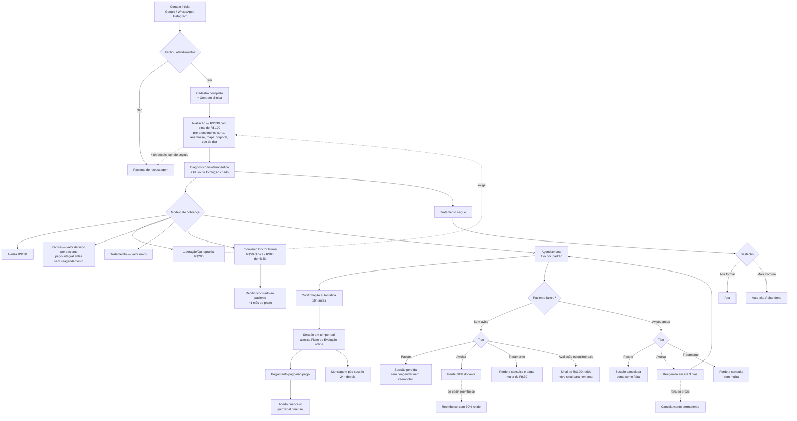

# Documento de Início de Projeto — Sistema de Gestão para Fisioterapeuta

  

> **Versão 8 — PRD inicial fechado, após revisão de lacunas.** As regras de negócio centrais estão definidas; os itens que restam (seção 12) são confirmações pontuais ou decisões técnicas que podem ser concluídas em paralelo, sem travar o início do desenvolvimento.

  

---

  

## 1. Visão Geral

  

Sistema de gestão para o consultório do Dr. Lucas Damasceno (fisioterapiaevo.com.br), com foco em **dor crônica e tratamento de coluna**. Hoje o atendimento é domiciliar, migrando aos poucos (\~2 meses) para clínica própria (endereço único). Volume médio: \~20 atendimentos/mês (fora avaliações, quiropraxia e liberação). Captação de pacientes: Google, WhatsApp (canal principal de agendamento e dúvidas) e Instagram.

  

**Modelo de acesso:** usuário único pelos próximos 2 anos; quando houver mais usuários, eles terão **papéis diferentes** entre si.

  

**Fontes já incorporadas neste documento:** ficha de avaliação em papel (Dr. Lucas Damasceno), termo de consentimento de uso de imagem, três modelos de contrato de prestação de serviço fisioterapêutico, e a taxonomia clínica de tipos de dor (PhD Léo Avila).

  

---

  

## 2. Tabela de Preços (base de hoje)

  

| Item | Valor | Observação |

| --- | --- | --- |

| Tratamento (valor único) | Valor **base**, referência R$ 3.000 | Cobre do primeiro dia até a **alta**, **sem limite de sessões**; valor editável antes de ser enviado/registrado no sistema, depois trava |

| Pacote de sessões | Definido por paciente (exemplo: 2 atendimentos por semana = R$ 4.900) | Frequência semanal, número de sessões e valor definidos caso a caso; valor editável antes de ser enviado/registrado no sistema, depois trava |

| Avaliação | R$ 330 (valor fixo) | Único item com valor realmente fixo. Inclui um **pré-atendimento curto**, com condutas básicas; o atendimento completo depende da análise feita na avaliação. Exige **sinal de R$ 100** (ver seção 5) |

| Sessão avulsa — liberação/quiropraxia | R$ 200 |  |

| Atendimento avulso comum | R$ 130 | Por sessão |

| Convênio Doctor Prime — clínica | R$ 50 | Por sessão |

| Convênio Doctor Prime — domicílio | R$ 80 | Por sessão |

  

**Regra de valor:** cada atendimento tem um **valor base editável antes de acontecer** (no caso de pacote e tratamento, editável antes de ser enviado/registrado no sistema). Depois de **executado**, o valor fica travado. A avaliação é a única exceção com valor já fixo (R$ 330). Vale para todos os demais tipos de cobrança.

  

**Convênio = sempre avulso.** Nenhum atendimento de convênio entra em lógica de pacote ou tratamento.

  

**Pacote:** todas as sessões são pagas de uma vez, no fechamento do pacote. Campos mínimos: frequência semanal, número total de sessões, dias definidos e valor total. O pacote tem **zero flexibilidade**: sem reagendamento de sessão, sem reembolso e sem alteração de valor depois de fechado.

  

---

  

## 3. Mensageria e Automações

  

| Automação | Gatilho |

| --- | --- |

| Confirmação de consulta | 16h antes do horário |

| Lembrete de pagamento | 3 dias antes do vencimento (mensal/quinzenal) |

| Mensagem pós-consulta (quiropraxia, liberação, avaliação) | 24h depois do atendimento, enviada automaticamente |

| Mensagem de repescagem | 48h após a avaliação, enviada automaticamente |

  

**"Postagem" (redes sociais):** por enquanto só um campo de observação livre.

  

**IA lendo WhatsApp automaticamente:** mantido como ideia de fase futura (fora do MVP) — ver riscos já discutidos (API oficial exigida, risco de banimento, questão de LGPD no processamento automático de dado clínico).

  

---

  

## 4. Regras Clínicas e Fluxo de Evolução

  

- **Pré-requisito obrigatório:** quiropraxia não pode ser realizada sem avaliação prévia registrada. **Liberação miofascial não exige avaliação prévia.**

- **Identificador do paciente:** o **CPF é identificador único** — o sistema não permite cadastro duplicado.

- **Histórico de alterações:** fichas clínicas (avaliação, anamnese, evolução) mantêm histórico completo de alterações (o que mudou, quando e por quem), sem sobrescrever o registro anterior.

- **Amplitude de movimento:** registrada como **Livre** ou **Limitada**; quando limitada, informa-se o **grau**. Se a função está 100% (livre), o grau não precisa ser preenchido.

- **Ficha de avaliação:** dados pessoais, dados clínicos, anamnese (histórico de doenças, cirurgias e lesões anteriores, etilismo, tabagismo, sono, alimentação, estresse, vida social, tipo de dor e o que piora/melhora), queixa principal, exame físico, mapa corporal (dermátomos C2–S5, frente e costas) e testes especiais, observações.

- **Fotos:** vinculadas à sessão específica em que foram tiradas.

- **Alta:** existe o conceito formal, mas a maioria dos pacientes sai do tratamento sem alta formal (status de "auto-alta"/abandono, distinto da alta dada pelo fisioterapeuta; a auto-alta é **marcada manualmente** pelo usuário).

  

### 4.1 Taxonomia do tipo de dor (campo em ramificações)

  

Baseado na classificação clínica de referência, o campo "tipo de dor" da anamnese deve funcionar como uma série de escolhas em cascata, não um campo livre:

  

1. **Natureza:** Sintoma (dor aguda) ou Doença (dor crônica)

2. **Categoria** *(só para dor crônica)*: Primária ou Secundária

   - Primária → Generalizada, SDRC, Cabeça ou face, Visceral, Musculoesquelética

   - Secundária → Neuropática, Pós-trauma ou cirurgia, Pós-câncer, Cabeça ou face, Visceral, Musculoesquelética

3. **Mecanismo neurofisiológico (gênese da dor):** Nociplástica (Aumentada / Verdadeira), Neuropática (Central / Periférica), Nociceptiva (QMC inflamatória / QMC não inflamatória / Mecânica), ou Origem não detectável

4. **Padrão temporal:** Contínua, Recorrente, ou Contínua + flare-up

5. **Região/sistema acometido:** Sistema somático, Sistema visceral, Cabeça ou face, Tronco, Membros superiores, Membros inferiores

  

O resultado final da combinação equivale aos 8 tipos de dor de referência (ex.: Química inflamatória, Química não inflamatória/isquêmica, Mecânica/manutenção tissular, Neuropática periférica, Neuropática central, Nociplástica verdadeira, Nociplástica aumentada, Origem não detectável) — cada um associável a uma ou mais regiões marcadas no mapa corporal.

  

### 4.2 Fluxo de Evolução (treinos)

  

Renomeado de "plano de treino" para **Fluxo de Evolução**. Estrutura:

  

- **Fluxo de Evolução** do paciente contém vários **Tratamentos** (Tratamento 1, Tratamento 2, Tratamento 3...).

- Cada **Tratamento** contém um ou mais **Exercícios**, cada um podendo combinar:

  - **Choque** (ex.: 30 minutos de determinado estímulo/aparelho)

  - **Exercício de movimentação** (ex.: flexão lateral de ombro)

    - Número de repetições (ex.: 10)

    - Número de séries

    - Tempo de intervalo de descanso entre séries

    - Localização do músculo trabalhado

- Um exercício pode ter choque e movimentação combinados no mesmo registro, ou apenas um dos dois.

- O **choque** de cada exercício é **vinculado a um Equipamento** cadastrado (rastreabilidade de uso do aparelho).

  

---

  

## 5. Agenda

  

- **Agendamento fixo por padrão**, mudando só por imprevisto do paciente ou do fisioterapeuta; atendimentos esporádicos são mais flexíveis conforme demanda.

- **Duração por tipo:** avaliação com tempo base configurável; sessão avulsa comum/convênio de reembolso = 40 min; convênio Doctor Prime = 30 min.

- **Bloqueio de horário duplicado:** o sistema não permite dois pacientes no mesmo horário; ao tentar, exibe aviso de que já existe um paciente agendado naquele horário.

- **Ausência avisada de consulta futura:** paciente pode ser retirado da agenda do dia correspondente.

- **Cancelamento de consulta:** feito manualmente pelo usuário do software por enquanto. O sistema deve ser desenhado de forma **desacoplada**, deixando espaço para uma automação futura (ex.: via webhook/integração) sem precisar ser reescrito.

  

**Regras de ausência do paciente**

  

| Situação | Pacote | Tratamento (valor único) | Consulta avulsa | Avaliação / quiropraxia |

| --- | --- | --- | --- | --- |

| Falta **sem aviso** | Perde a sessão; **não paga nada** e não há reagendamento | Perde a consulta **e paga multa de R$ 39** (30% de R$ 130), que deve ser **informada ao paciente** | Perde **30% do valor** (R$ 39); se pedir reembolso, esse percentual é retido | **Sinal de R$ 100 fica com o fisioterapeuta**; para remarcar, paga novo sinal |

| Falta **com aviso prévio** | Sessão cancelada e contada como falta; sem reagendamento | Perde a consulta, sem reagendamento (sessões ilimitadas dentro do valor fixo); **sem multa** | Pode **reagendar em até 3 dias** | *A definir* |

  

- **Registro de presença e falta:** feito **manualmente pelo usuário**. A Agenda tem um botão **"Confirmar presença"**, e a falta sem aviso também é informada pelo usuário. A multa de R$ 39 do plano de tratamento só vale em **falta sem aviso**.

- **Justificativa só vale se o paciente avisar antes** da consulta que não vai comparecer. Justificativa apresentada depois da falta não vale.

- **Janela de 3 dias (avulsa):** passado o prazo sem reagendar, a consulta vira **cancelamento permanente**. O sistema exibe um **indicador visual** mostrando se a consulta ainda está dentro da janela ou se o prazo expirou. A avaliação do aviso/justificativa é feita **manualmente** pelo usuário.

- **Sinal de R$ 100 (avaliação e quiropraxia):** sempre pago antes do atendimento. Quando o paciente comparece, o sinal é **abatido** do valor total.

- **Reembolso:** só existe para **sessões avulsas**, nunca para pacote.

  

---

  

## 6. Aba de Pendências

  

Reúne: pacientes que precisam reagendar (dentro da janela dos 3 dias), pacientes que não pagaram e pendência do **Contrato clínica** (nome provisório do documento assinado pelo paciente que autoriza o uso de imagem).

  

**Validação do Contrato clínica:** o sistema verifica se existe contrato para o paciente. Se existe, o fisioterapeuta pode usar imagem/vídeo normalmente, sem nenhum aviso. Se **não existe**, o **anexo de imagem ou vídeo é bloqueado**. Por enquanto o bloqueio vale **apenas para mídia**; o atendimento segue normal. Restrições adicionais podem ser incluídas depois.

  

---

  

## 7. Financeiro

  

- Despesas automáticas/recorrentes e manuais, ambas suportadas.

- Acertos financeiros quinzenais e mensais.

- Investimentos: nome, categoria (gasto fixo, gasto variável da clínica, equipamentos fixos, material descartável, marketing), valor pago, data.

- Recibo de convênio: prazo médio de \~1 mês.

- Pagamento: por enquanto só pago/não pago; gateway futuro como generic domain via CLI.

- **Pagamento antecipado:** o paciente sempre paga antes da consulta; consulta avulsa não paga sai da agenda. Por enquanto, tolera-se o pagamento até 5 dias depois.

- Nota fiscal: emissão manual (Receita Saúde); sistema só guarda/vincula o arquivo.

- Campo único indicando se o atendimento é convênio ou não.

  

---

  

## 8. Equipamentos

  

Entidade Equipamentos com subtela de Manutenção de Aparelhos. Alerta de manutenção dispara 30 dias antes da data necessária.

  

**Equipamentos a comprar:** o item "a comprar" é o **mesmo registro** do equipamento; ao ser comprado, só muda o status e ele é realocado para a lista de comprados.

  

---

  

## 9. Sincronização Offline

  

- Ficha de avaliação funcionando offline é **prioridade alta** do MVP.

- **Agenda e Financeiro também funcionam offline**, para permitir marcar presença/falta e lançar pagamento durante atendimentos domiciliares sem internet.

- **Fluxo de Evolução também precisa estar disponível offline.** Toda vez que o dispositivo estiver online, o sistema sincroniza o Fluxo de Evolução de cada paciente (tratamentos e exercícios cadastrados), mantendo uma cópia local sempre atualizada — meta inicial de no máximo **2 dias** de defasagem entre uma sincronização e outra (valor de partida, ajustável). Isso garante que, mesmo sem internet, o usuário consegue abrir o tratamento já cadastrado de um paciente e aplicá-lo durante a sessão em tempo real.

- Conflito de dados do mesmo paciente entre dispositivos: cenário considerado **raro/muito difícil** de acontecer, mas quando ocorrer, a solução é exibir as duas versões completas lado a lado e deixar o usuário escolher qual levar adiante (merge estilo GitHub).

- Dados salvos localmente e sincronizados quando há internet.

  

---

  

## 10. Fluxo do Negócio — Visão Completa

  

### 10.1 Da captação ao primeiro atendimento

  

1. **Contato inicial** chega por Google, WhatsApp (principal) ou Instagram.

2. Se o contato **não fecha** atendimento → vira **paciente de repescagem** (dados básicos registrados manualmente). O sistema dispara uma **mensagem automática de repescagem 48h depois da avaliação** para pacientes que fizeram avaliação mas não seguiram adiante *(aplica-se a quem chegou a avaliar)*.

3. Se o contato **fecha** → **cadastro completo do paciente** (dados pessoais, clínicos e Contrato clínica pendente de assinatura).

4. **Avaliação** é agendada (duração com tempo base configurável, valor fixo de R$ 330). É nela que entram: anamnese completa, mapa corporal, classificação do tipo de dor (taxonomia em cascata), queixa principal, exame físico e testes especiais.

5. A partir da avaliação, o fisioterapeuta define o **diagnóstico fisioterapêutico** e monta o **Fluxo de Evolução** do paciente (Tratamento 1, 2, 3... com exercícios de choque/movimentação).

  

### 10.2 Modelo de cobrança e agendamento

  

6. Definição do modelo: **consulta avulsa** (R$ 130), **sessão avulsa de liberação/quiropraxia** (R$ 200), **pacote** (valor e número de sessões definidos por paciente), **tratamento** (valor único até o fim) ou **convênio Doctor Prime** (R$ 50 clínica / R$ 80 domicílio — sempre tratado como avulso).

7. **Quiropraxia exige avaliação prévia registrada** — o sistema deve bloquear o agendamento desse tipo de sessão sem essa pré-condição. Liberação miofascial não exige.

8. Agendamento criado — **fixo por padrão**, só muda por imprevisto; atendimentos esporádicos são mais flexíveis. O sistema **bloqueia horário duplicado** e avisa que já existe paciente naquele horário.

9. **Pacote**: todas as sessões são pagas de uma vez, no fechamento do pacote, antes das sessões ocorrerem; sem reagendamento e sem reembolso.

  

### 10.3 Ciclo de cada sessão

  

10. **Confirmação automática** enviada 16h antes do horário.

11. Sessão acontece. Fisioterapeuta **acessa o Fluxo de Evolução** do paciente (disponível mesmo offline, sincronizado a cada conexão, com defasagem máxima de \~2 dias) e aplica/registra o tratamento em tempo real.

12. **Pagamento** registrado como pago/não pago (Pix, crédito ou débito).

13. **Mensagem pós-sessão automática 24h depois**, para quiropraxia, liberação e avaliação, perguntando o estado do paciente.

14. Se houve **falta sem aviso**: **pacote** perde a sessão sem pagar nada; **tratamento** perde a consulta e paga multa de R$ 39 (informada ao paciente); **avulsa** perde 30% do valor; **avaliação/quiropraxia** perde o sinal de R$ 100 (e paga novo sinal para remarcar).

15. Se houve **aviso prévio**: na **avulsa** o paciente pode reagendar em até 3 dias — depois disso, cancelamento permanente; no **pacote** a sessão é cancelada e conta como falta; no **tratamento** a consulta é perdida, sem reagendamento e sem multa. Justificativa só vale se avisar antes. Reembolso só existe para avulsas.

  

### 10.4 Financeiro e documentos

  

16. **Acertos financeiros** fechados quinzenal e mensalmente (receita, despesas fixas/variáveis — automáticas ou manuais —, investimentos).

17. Para convênio: **recibo vinculado ao paciente**, com prazo médio de recebimento de \~1 mês; nota fiscal emitida manualmente fora do sistema (Receita Saúde) e só anexada/vinculada ao paciente.

18. **Aba de pendências** reúne em um só lugar: pacientes a reagendar, pacientes inadimplentes, pendência do Contrato clínica.

  

### 10.5 Encerramento do tratamento

  

19. Tratamento segue até **alta formal** (dada pelo fisioterapeuta) ou, no caso mais comum, **auto-alta** (paciente simplesmente para de comparecer, sem alta formal).

20. Dados do paciente **nunca são excluídos** do sistema, independente do desfecho.

  

### 10.6 Diagrama

  

  

---

  

## 11. Arquitetura Técnica — Resumo Preliminar (a aprofundar com você depois)

  

Você já trouxe uma proposta técnica inicial, registrada aqui como ponto de partida para a próxima etapa (ainda não é documento de arquitetura final):

  

- **Autenticação:** login inicial por e-mail/senha + MFA; depois, biometria nativa — Touch ID no macOS (via `LocalAuthentication`, chave guardada no Keychain/Secure Enclave) e Windows Hello no Windows (via `UserConsentVerifier`/WebAuthn, chave protegida por DPAPI + TPM 2.0).

- **Banco local criptografado:** SQLCipher (SQLite) ou Realm com AES-256; chave liberada para a RAM só após autenticação biométrica.

- **Disco:** recomendação de exigir FileVault ativo no Mac e BitLocker ativo no Windows.

- **Sincronização:** fila de mutações offline, sincronização incremental (delta sync) via TLS 1.3 ao reconectar, resolução de conflito (last-write-wins com timestamp ou merge manual — consistente com o modelo de merge definido na seção 9), TTL de cache local (ex.: Fluxo de Evolução sincronizado a cada conexão, com defasagem máxima de \~2 dias) e bloqueio de novas gravações offline após X dias sem check-in online.

- **Auditoria (LGPD):** logs locais criptografados e assinados digitalmente das ações sobre prontuário, enviados ao servidor com prioridade na reconexão.

- **Stack multiplataforma (Mac + Windows):** cogitado Tauri 2.0 ou Electron (alternativas: Flutter Desktop, .NET MAUI).

  

*Combinamos discutir e fechar essa arquitetura com mais profundidade em uma etapa dedicada — o resumo acima é só para não perder o que já foi levantado.*

  

---

  

## 12. Checklist Final — O que ainda falta fechar

  

- [ ] **Multa contratual por atraso** (10% + 2% ao mês nos modelos de contrato) — decidir depois

- [ ] **Cláusulas de rescisão dos modelos de contrato** (acerto proporcional) — adaptar depois à regra de pacote sem reembolso

- [ ] **Avaliação/quiropraxia com aviso prévio:** nada foi definido sobre o que acontece com o sinal

- [ ] **Contrato clínica:** definir nome oficial e conteúdo; restrições além do bloqueio de mídia entram depois

- [ ] **Stack final** (Tauri x Electron x Flutter x .NET MAUI) e demais decisões técnicas — etapa de arquitetura

- [ ] **Detalhar LGPD** (criptografia, backup, controle de acesso multiusuário) com base no resumo da seção 11

- [ ] **Módulo de IA lendo WhatsApp** — fase futura, fora do MVP

  

---

  

## 13. Próximos passos sugeridos

  

Com as regras de negócio já bem fechadas, os itens acima não bloqueiam o início da documentação formal. Sugestão de documentos para a etapa seguinte:

  

1. **Este documento (regras de negócio)** → considerar fechado como v7 (PRD inicial).

2. **Modelo de domínio (DDD)** — publicado como documento separado: bounded contexts (Pacientes, Agenda, Financeiro, Fluxo de Evolução, Equipamentos, Notificações), entidades, agregados e eventos de domínio.

3. **Documento de arquitetura técnica:** evoluir a seção 11 até virar o documento definitivo (stack, segurança, sincronização).

4. **Dicionário de dados:** campos e tipos de cada entidade (Paciente, Sessão, Tratamento, Exercício, Lançamento financeiro etc.), incluindo a taxonomia de dor da seção 4.1.

  

---

  

*Documento reflete tudo que foi definido até agora. Os itens da seção 12 podem ser resolvidos em paralelo, durante a modelagem de domínio e a etapa de arquitetura técnica, sem travar o início do desenvolvimento.*