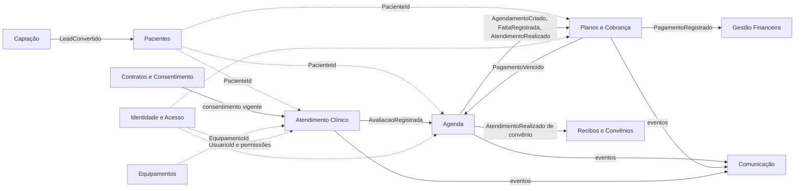
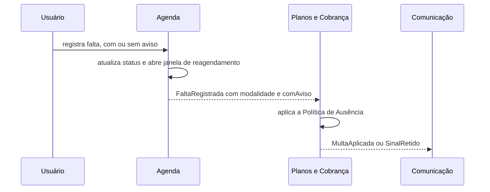
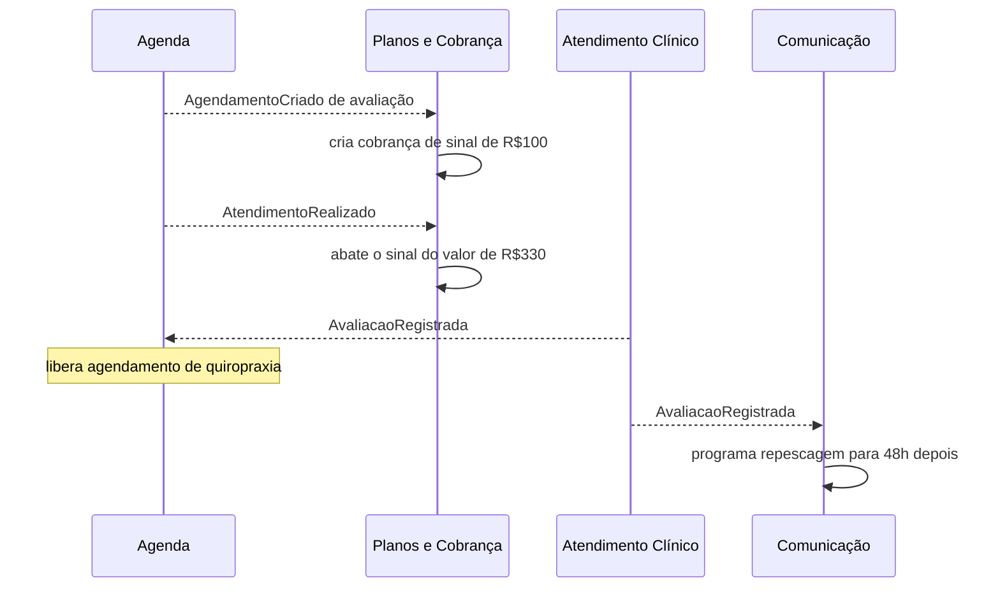

# Modelo de Domínio (DDD) — Estruturação dos Contextos

> Derivado do PRD v8. Organiza as regras de negócio em **bounded contexts**, agregados, eventos de domínio e relações entre contextos. Nomes em português, seguindo a linguagem do consultório.

---

## 1. Visão estratégica

### 1.1 Classificação dos subdomínios

| Contexto | Tipo | Por quê |
| --- | --- | --- |
| **Atendimento Clínico** | **Core** | É o diferencial do sistema: avaliação, taxonomia de dor, fluxo de evolução, protocolo de sessão, tudo funcionando offline |
| **Agenda** | **Core** | Concentra as regras operacionais mais delicadas: horário fixo, bloqueio de duplicidade, ausência, janela de reagendamento |
| Planos e Cobrança | Suporte, com regras próprias | Sinal, multa, modalidades e travamento de valor são específicos do negócio. Modele com cuidado, mas sem gateway por enquanto |
| Pacientes | Suporte | Cadastro e identidade (CPF) |
| Captação | Suporte | Leads e repescagem |
| Gestão Financeira | Suporte | Despesas, investimentos, fechamentos e relatórios |
| Recibos e Convênios | Suporte | Controle de recibos pendentes/enviados |
| Contratos e Consentimento | Suporte (crítico para LGPD) | Contrato clínica e bloqueio de mídia |
| Equipamentos | Suporte | Compra e manutenção de aparelhos |
| Comunicação | Suporte | Mensagens automáticas e lembretes; o canal (WhatsApp) é genérico |
| **Identidade e Acesso** | **Genérico**, modelado como contexto próprio | Login, MFA, dispositivos e papéis. Use bibliotecas consolidadas atrás de uma porta `Autenticador`, para poder trocar a implementação |
| Sincronização, Auditoria, Arquivos, Geração de Documentos | **Genérico** | Use soluções prontas sempre que possível |

### 1.2 Recomendação de arquitetura: monólito modular

Cada contexto vira um **módulo** dentro de um único aplicativo, não um serviço separado. Motivos: usuário único, app desktop offline-first, equipe pequena. Os módulos conversam por **eventos de domínio em memória** e por interfaces explícitas, nunca acessando as tabelas uns dos outros. Se um dia algum contexto precisar virar serviço, a fronteira já está pronta.

Regra de ouro para o offline: **o agregado é a unidade de consistência, de sincronização e de conflito.** A tela de "duas versões lado a lado" compara versões do mesmo agregado (ex.: uma Avaliação, um Fluxo de Evolução).

---

## 2. Mapa de contextos



Legenda: seta cheia = evento ou chamada entre contextos; seta pontilhada = apenas referência por identificador.

**Regra de integração:** um contexto guarda só o **ID** de entidades de outro contexto (`PacienteId`, `EquipamentoId`, `AgendamentoId`), nunca o objeto inteiro. Se precisar de um dado (ex.: nome do paciente na agenda), mantém uma cópia somente leitura, atualizada por evento.

---

## 3. Linguagem ubíqua

| Termo | Significado | Contexto |
| --- | --- | --- |
| **Lead** | Pessoa que entrou em contato mas ainda não fechou atendimento (repescagem) | Captação |
| **Paciente** | Pessoa cadastrada, identificada por CPF | Pacientes |
| **Agendamento** | Horário marcado para um atendimento | Agenda |
| **Atendimento** | O agendamento que de fato aconteceu | Agenda |
| **Sessão** | O registro clínico do que foi feito no atendimento (protocolo) | Atendimento Clínico |
| **Avaliação** | Primeiro atendimento completo, com anamnese e pré-atendimento curto | Atendimento Clínico |
| **Fluxo de Evolução** | Plano clínico do paciente, composto por Tratamentos numerados | Atendimento Clínico |
| **Tratamento (clínico)** | "Tratamento 1, 2, 3...": etapa do Fluxo de Evolução com exercícios | Atendimento Clínico |
| **Plano Tratamento (comercial)** | Modalidade de cobrança de valor único até a alta, sem limite de sessões | Planos e Cobrança |
| **Pacote** | Modalidade com frequência e número de sessões fechados | Planos e Cobrança |
| **Avulsa** | Consulta cobrada por sessão | Planos e Cobrança |
| **Sinal** | R$ 100 antecipados em avaliação e quiropraxia | Planos e Cobrança |
| **Contrato clínica** | Documento assinado que autoriza uso de imagem (nome provisório) | Contratos e Consentimento |
| **Usuário** | Pessoa com acesso ao sistema (hoje só o fisioterapeuta) | Identidade e Acesso |
| **Dispositivo** | Computador registrado para usar o app (ex.: o MacBook do consultório) | Identidade e Acesso |
| **Papel** | Conjunto de permissões de um usuário (hoje só o Proprietário) | Identidade e Acesso |
| **Sessão de login** | Período em que o usuário está autenticado no servidor | Identidade e Acesso |

**Segunda colisão:** "sessão" também aparece como **Sessão** clínica (o registro do atendimento) e **Sessão de login** (o período autenticado). Use sempre o nome qualificado (`Clinico.Sessao` e `Identidade.SessaoDeLogin`).

**Atenção a uma colisão de linguagem:** a palavra **"tratamento"** significa duas coisas diferentes. No contexto clínico é uma etapa do Fluxo de Evolução ("Tratamento 1"). No contexto comercial é uma modalidade de cobrança. Isso é exatamente o motivo de existirem contextos separados. No código, mantenha os nomes distintos (`Clinico.Tratamento` e `Cobranca.PlanoTratamento`) e nunca compartilhe a mesma classe entre os dois.

---

## 4. Contextos em detalhe

### 4.1 Captação

**Responsabilidade:** registrar contatos que ainda não viraram pacientes e apoiar a repescagem.

| Agregado | Conteúdo | Regras |
| --- | --- | --- |
| **Lead** (raiz) | nome, telefone, origem (Google, WhatsApp, Instagram), observações, status (em contato, repescagem, convertido) | Dados básicos inseridos manualmente. Lead **não** é Paciente: não exige CPF. Ao fechar, gera o Paciente (evento `LeadConvertido`) |

**Emite:** `LeadCriado`, `LeadConvertido`.

---

### 4.2 Pacientes

**Responsabilidade:** identidade e dados cadastrais.

| Agregado | Conteúdo | Regras |
| --- | --- | --- |
| **Paciente** (raiz) | `PacienteId`, **CPF** (VO), nome, data de nascimento, profissão atual e a de maior tempo, **Endereço** (VO), contatos, **ContatoDeEmergência** (VO), situação (ativo ou arquivado) | **CPF único**. **Nunca é excluído**, só arquivado. **Idade é calculada** a partir do nascimento, nunca gravada. Alterações mantêm histórico |

**Value objects:** `CPF`, `Endereço`, `Telefone`, `ContatoDeEmergência`. **Emite:** `PacienteCadastrado`, `PacienteArquivado`, `DadosDoPacienteAlterados`.

---

### 4.3 Atendimento Clínico (core)

**Responsabilidade:** tudo que é clínico, do primeiro exame à alta.

| Agregado | Conteúdo | Regras |
| --- | --- | --- |
| **Avaliação** (raiz) | anamnese (doenças, cirurgias e lesões anteriores, etilismo, tabagismo, sono, alimentação, estresse, vida social, piora/melhora), **TipoDeDor** (VO em cascata), **MapaCorporal** (VO, uma ou mais regiões de dermátomo C2–S5), queixa principal, exame físico, testes especiais, diagnóstico médico, médico, medicamentos, diagnóstico fisioterapêutico, pré-atendimento curto, observações | Pode ser preenchida **offline** (prioridade máxima). Todas as alterações geram **revisão** (histórico append-only) |
| **FluxoDeEvolução** (raiz) | `PacienteId`, lista ordenada de **Tratamentos** (1, 2, 3...), cada um com **Exercícios**; situação (em andamento, alta formal, auto-alta) | Tratamentos numerados em sequência. **A auto-alta é marcada manualmente** pelo usuário. Sincronizado a cada conexão, defasagem máxima de \~2 dias. Mantém histórico de alterações |
| **Sessão** (raiz) | `AgendamentoId`, `PacienteId`, `TratamentoId` aplicado, **protocolo**: estado de chegada, estado de saída, nível de dor, **AmplitudeDeMovimento**, abordagem, potência; **Mídias** (fotos e vídeos) | Todos os campos do protocolo são **obrigatórios**. Mídia só pode ser anexada se existir **consentimento de imagem vigente** (consulta ao contexto Contratos). Foto sempre vinculada à sessão |

**Exercício** (entidade dentro do Tratamento): tipo; **movimentação** (repetições, séries, descanso, músculo/localização) e/ou **choque** (duração, `EquipamentoId`). Pode ter só um dos dois ou os dois combinados.

**Value objects:** `TipoDeDor` (natureza, categoria, subcategoria, mecanismo, padrão temporal, região), `RegiãoDeDermátomo`, `AmplitudeDeMovimento` (**Livre** ou **Limitada com grau**; grau dispensado quando a função está 100%), `EstadoDeChegada`, `NívelDeDor` (escala numérica a definir).

**Emite:** `AvaliaçãoRegistrada`, `SessãoRegistrada`, `TratamentoIniciado`, `AltaConcedida`, `AutoAltaRegistrada`. **Consome:** `AtendimentoRealizado` (para abrir o registro da sessão).

**Observação:** o **laudo/relatório funcional** não é agregado; é um documento gerado a partir da Avaliação e do Fluxo de Evolução (serviço de geração de documentos).

---

### 4.4 Agenda (core)

**Responsabilidade:** horários, presença, falta e janela de reagendamento. **Não decide a consequência financeira da falta**, só registra o fato.

| Agregado | Conteúdo | Regras |
| --- | --- | --- |
| **Agendamento** (raiz) | `PacienteId`, tipo (avaliação, quiropraxia, liberação, sessão), início e fim, local (clínica ou domicílio com endereço), status (agendado, confirmado, realizado, falta sem aviso, ausência avisada, reagendado, cancelamento permanente), modalidade de origem | **Sem sobreposição de horário**: bloqueia e avisa que já existe paciente no horário. **Quiropraxia exige Avaliação registrada**; liberação não exige. **Duração por tipo:** avaliação com tempo base configurável, avulsa e convênio de reembolso 40 min, Doctor Prime 30 min. **Pacote: nunca reagenda.** Avulsa com aviso: reagenda em até 3 dias; passado o prazo, cancelamento permanente. Cancelamento é manual, com porta aberta para automação. **Presença e falta são registradas manualmente:** o botão *Confirmar presença* gera `AtendimentoRealizado`, e a falta (com ou sem aviso) é informada pelo usuário |
| **SérieFixa** (raiz) | padrão semanal recorrente de um paciente | Gera os agendamentos da série. Muda só por imprevisto. Atendimentos esporádicos ficam fora da série |

**Read models (consultas, não agregados):**

- **Frequência do paciente** = atendimentos realizados menos faltas. Reagendamento avisado não conta como falta.
- **Consultas reagendáveis** (indicador visual da janela de 3 dias).
- **Pacientes do dia** (Dashboard).

**Emite:** `AgendamentoCriado`, `AtendimentoConfirmado`, `AtendimentoRealizado`, `FaltaRegistrada` (com `comAviso`), `AgendamentoReagendado`, `CancelamentoPermanenteDecretado`. **Consome:** `AvaliaçãoRegistrada` (libera quiropraxia), `PagamentoVencido` (retira avulsa não paga da agenda).

---

### 4.5 Planos e Cobrança

**Responsabilidade:** o que o paciente contratou, quanto deve e as consequências financeiras de presença e ausência.

| Agregado | Conteúdo | Regras |
| --- | --- | --- |
| **PlanoContratado** (raiz) | `PacienteId`, modalidade (**Avulsa**, **Pacote**, **PlanoTratamento**), valor base, situação do valor (editável ou travado), flag de convênio (Doctor Prime ou reembolso) | **Valor base editável até ser registrado/executado; depois é imutável.** Avaliação tem valor fixo de R$ 330. **Pacote:** frequência semanal, total de sessões, dias definidos, valor total, saldo de sessões, pago de uma vez e antes. **Plano Tratamento:** valor único até a alta, sem limite de sessões. **Convênio é sempre avulso** (R$ 50 clínica, R$ 80 domicílio) |
| **Cobrança** (raiz) | origem, tipo (sessão, avaliação, sinal, pacote, plano, multa), valor, status (**pago**, **não pago**), forma (Pix, crédito, débito), data | Paciente paga antes; avulsa não paga sai da agenda, com tolerância atual de 5 dias. Valor **travado** após execução |
| **Reembolso** (raiz) | cobrança de origem, valor, percentual retido | **Só para avulsa.** Nunca para pacote. Com falta sem aviso, 30% é retido |

**Política de Ausência** (serviço de domínio, o ponto central deste contexto). Entrada: modalidade e `comAviso`.

| Situação | Pacote | Plano Tratamento | Avulsa | Avaliação / quiropraxia |
| --- | --- | --- | --- | --- |
| Falta sem aviso | perde a sessão, sem cobrança | perde a consulta + **multa R$ 39** (só sem aviso), informada ao paciente | retém **30%** (R$ 39) | **sinal de R$ 100 retido**; novo sinal para remarcar |
| Falta com aviso | cancelada, conta como falta | perde a consulta, **sem multa** | reagenda em até 3 dias | a definir |

**Sinal:** R$ 100, sempre antes. Ao comparecer, é **abatido** do valor total (R$ 330 na avaliação, R$ 200 na quiropraxia).

**Emite:** `CobrançaCriada`, `PagamentoRegistrado`, `PagamentoVencido`, `MultaAplicada`, `SinalRetido`, `ReembolsoRealizado`, `ValorTravado`. **Consome:** `AgendamentoCriado` (cria sinal de avaliação ou quiropraxia), `AtendimentoRealizado` (trava valor, abate sinal), `FaltaRegistrada` (aplica a política).

**Reservado para o futuro:** multa contratual por atraso (10% + 2% ao mês), gateway de pagamento como domínio genérico via CLI, mensalidade.

---

### 4.6 Gestão Financeira

**Responsabilidade:** visão gerencial do consultório.

| Agregado | Conteúdo | Regras |
| --- | --- | --- |
| **Despesa** (raiz) | descrição, tipo (**fixa** ou **variável**), origem (**automática** recorrente ou **manual**), valor, data | Despesa automática é gerada por uma **RegraDeRecorrência** |
| **Investimento** (raiz) | nome, categoria (gasto fixo, gasto variável da clínica, equipamentos fixos, material descartável, marketing), valor pago, data |  |
| **FechamentoFinanceiro** (raiz) | período (quinzenal ou mensal), totais | Fechado quinzenal e mensalmente |

**Receitas** não são lançadas aqui: chegam pelo evento `PagamentoRegistrado` e viram uma projeção local (isso funciona bem offline). **Read models:** resumo do dia, da semana e do mês; gráfico de barras (receita, despesa e total) para 1, 3 e 6 meses; pacientes pagos, não pagos e pendentes. **Consome:** `PagamentoRegistrado`. **Opcional:** `EquipamentoComprado` pode gerar um Investimento (decidir).

---

### 4.7 Recibos e Convênios

**Responsabilidade:** recibos de convênio e vínculo da nota fiscal.

| Agregado | Conteúdo | Regras |
| --- | --- | --- |
| **ReciboDeConvênio** (raiz) | `PacienteId`, atendimentos incluídos, convênio (Doctor Prime ou reembolso), status (**pendente** ou **enviado**), prazo médio de \~1 mês, **nota fiscal anexada** (arquivo) | A **emissão é manual** no Receita Saúde; o sistema só guarda e vincula o arquivo ao paciente. Fluxo igual para os dois convênios (a verificar) |

**Consome:** `AtendimentoRealizado` com convênio (cria recibo pendente).

---

### 4.8 Contratos e Consentimento

**Responsabilidade:** documentos assinados e autorização de uso de imagem.

| Agregado | Conteúdo | Regras |
| --- | --- | --- |
| **ContratoClínica** (raiz, nome provisório) | `PacienteId`, versão do modelo, status (**pendente**, **assinado**, **revogado**), dados da assinatura (método a decidir), cláusula de tratamento de dados sensíveis (LGPD) | **Sem contrato assinado, o anexo de imagem ou vídeo é bloqueado.** Só mídia por enquanto; o atendimento segue normal. Restrições adicionais entram depois, então modele como **lista de políticas extensível**. Prevê **revogação**. Mantém histórico |

**Interface oferecida aos outros contextos:** `consentimentoDeImagemVigente(pacienteId) → sim ou não`. O Atendimento Clínico consulta essa interface por uma camada anticorrupção, sem conhecer a estrutura interna do contrato.

**Emite:** `ContratoAssinado`, `ContratoRevogado`.

---

### 4.9 Equipamentos

| Agregado | Conteúdo | Regras |
| --- | --- | --- |
| **Equipamento** (raiz) | nome, status (**a comprar** ou **comprado**), custo estimado, prioridade, **Manutenções** (data prevista, histórico) | Item "a comprar" e item comprado são o **mesmo registro**; só muda o status e ele vai para a lista de comprados. **Alerta 30 dias antes** da manutenção |

O Exercício do Atendimento Clínico referencia o equipamento do choque apenas por `EquipamentoId`. **Emite:** `EquipamentoComprado`, `ManutençãoVencendo`.

---

### 4.10 Comunicação e Lembretes

| Agregado | Conteúdo | Regras |
| --- | --- | --- |
| **MensagemProgramada** (raiz) | destinatário, tipo, momento de envio, status (programada, enviada, cancelada, falhou) | **Confirmação** 16h antes; **lembrete de pagamento** 3 dias antes; **pós-sessão** 24h depois (quiropraxia, liberação, avaliação); **repescagem** 48h após a avaliação. Se o agendamento é cancelado ou remarcado, a mensagem é cancelada |
| **LembreteDoUsuário** (raiz) | `PacienteId`, texto | Espaço para o usuário não esquecer mensagens do paciente |
| **ScriptDeContato** (raiz) | texto-modelo, empresa de destino | Scripts para contato com empresas |

O **canal** (WhatsApp) é uma **porta** (`CanalDeMensagem`) com adaptador trocável, porque o envio automático depende de decisão técnica ainda aberta (WhatsApp Business API). **Consome:** `AgendamentoCriado`, `AtendimentoRealizado`, `AvaliaçãoRegistrada`, `CobrançaCriada`, `AgendamentoReagendado`.

---

### 4.11 Identidade e Acesso

**Responsabilidade:** quem pode entrar no sistema, de qual computador e com que permissões. É um subdomínio **genérico**, mas fica como contexto próprio, atrás da porta `Autenticador`, para que uma troca futura de implementação (ex.: provedor gerenciado) não toque nos demais contextos.

| Agregado | Conteúdo | Regras |
| --- | --- | --- |
| **Usuário** (raiz) | `UsuárioId`, nome, e-mail, situação (ativo, bloqueado, desativado), **papéis**, credencial de senha (somente o hash), fator **MFA** (TOTP + códigos de recuperação) | E-mail único. **Sem cadastro público**: a conta é criada pelo administrador ou por convite. **Sempre existe ao menos um Proprietário ativo.** MFA obrigatório no primeiro acesso. A conta **nunca é excluída**, só desativada |
| **Dispositivo** (raiz) | `DispositivoId`, `UsuárioId`, apelido, plataforma (macOS ou Windows), data de registro, último check-in online, biometria habilitada, situação (ativo ou revogado) | Registrado no primeiro login; o `DispositivoId` é o mesmo usado na sincronização. **Dispositivo revogado não sincroniza** e é bloqueado na próxima conexão. Passou do limite de dias offline (a definir): bloqueia novas gravações até um check-in |
| **SessãoDeLogin** (raiz, no servidor) | usuário, dispositivo, família de refresh tokens, validade, situação | Refresh token **rotativo**: reutilizar um token antigo revoga a família inteira. Revogável a qualquer momento |

**Papel e Permissão** (value objects): o Papel agrupa permissões por contexto (ex.: `clínico:ler`, `clínico:escrever`, `financeiro:ler`, `agenda:escrever`). Hoje existe só o **Proprietário**, com todas as permissões, mas o código **já checa permissão em cada caso de uso**. Assim, a chegada de Recepção ou Financeiro (daqui a \~2 anos) não exige reescrever nada.

**Desbloqueio local** (parte do app, não é agregado): o app tem um estado local *bloqueado* ou *desbloqueado*. Desbloquear (biometria ou senha mestre) libera a chave do banco local e funciona **offline**. É um mecanismo separado do login no servidor, que precisa de internet. Detalhes e opções na seção 6 do documento de arquitetura técnica.

**Autoria:** todo contexto grava `UsuárioId` e `DispositivoId` em cada revisão do histórico de alterações. Eles chegam por um `ContextoDeAcesso` (usuário, dispositivo, permissões) injetado na camada de aplicação. **Nenhum contexto consulta a Identidade diretamente.**

**Emite:** `UsuárioCriado`, `MfaConfigurado`, `LoginRealizado`, `LoginFalhou`, `DispositivoRegistrado`, `DispositivoRevogado`, `SenhaAlterada`, `SessãoRevogada`, `UsuárioBloqueado`. **Consumidores:** Auditoria (todos) e Sincronização (`DispositivoRevogado`).

---

### 4.12 Contextos genéricos e transversais

| Contexto | O que cobre |
| --- | --- |
| **Sincronização Offline** | Fila de mutações, delta sync, conflito mostrando duas versões do agregado lado a lado, cache local, bloqueio por inatividade. **Offline em:** Ficha de Avaliação (prioridade máxima), Fluxo de Evolução, Agenda e Financeiro |
| **Auditoria** | Histórico de alterações e logs de acesso (LGPD). Sugestão: versões append-only por agregado clínico, sem event sourcing completo |
| **Arquivos** | Fotos, vídeos, contratos assinados, notas fiscais |
| **Geração de Documentos** | PDF do laudo/relatório funcional |

**Painel de Pendências e Dashboard** não são contextos: são **read models** que compõem dados de Agenda (a reagendar), Cobrança (não pagos) e Contratos (contrato pendente).

---

## 5. Processos entre contextos

### 5.1 Falta do paciente



A Agenda só registra o fato. Quem decide a consequência financeira é a Cobrança, e assim as duas regras mudam de forma independente.

### 5.2 Avaliação, sinal e liberação da quiropraxia



---

## 6. Catálogo de eventos

| Evento | Emissor | Consumidores | Efeito |
| --- | --- | --- | --- |
| `LeadConvertido` | Captação | Pacientes | Cria o Paciente |
| `AvaliaçãoRegistrada` | Clínico | Agenda, Comunicação | Libera quiropraxia; programa repescagem |
| `AgendamentoCriado` | Agenda | Cobrança, Comunicação | Cria sinal; programa confirmação |
| `AtendimentoRealizado` | Agenda | Cobrança, Clínico, Recibos, Comunicação | Trava valor e abate sinal; abre sessão; cria recibo de convênio; programa pós-sessão |
| `FaltaRegistrada` | Agenda | Cobrança | Aplica Política de Ausência |
| `PagamentoVencido` | Cobrança | Agenda | Retira avulsa não paga da agenda |
| `PagamentoRegistrado` | Cobrança | Gestão Financeira | Lança receita |
| `MultaAplicada`, `SinalRetido` | Cobrança | Comunicação, Gestão Financeira | Informa o paciente; lança receita |
| `ContratoAssinado`, `ContratoRevogado` | Contratos | (consulta) Clínico | Libera ou bloqueia mídia |
| `ManutençãoVencendo` | Equipamentos | Comunicação | Alerta 30 dias antes |
| `LoginRealizado`, `LoginFalhou` | Identidade | Auditoria | Registro de acesso (LGPD) |
| `DispositivoRevogado` | Identidade | Sincronização, Auditoria | Bloqueia a sincronização e o uso do dispositivo |

---

## 7. Estrutura de módulos sugerida

```
src/
  captacao/             domain/  application/  infrastructure/
  pacientes/
  atendimento-clinico/
  agenda/
  planos-e-cobranca/
  gestao-financeira/
  recibos-e-convenios/
  contratos-e-consentimento/
  equipamentos/
  comunicacao/
  identidade-e-acesso/
  compartilhado/        (VOs genéricos: Dinheiro, CPF, Período; barramento de eventos)
  infraestrutura/       (sincronização, auditoria, arquivos, documentos)
```

Dentro de cada módulo, a regra de dependência da Clean Architecture: `domain` não depende de nada; `application` (casos de uso) depende de `domain`; `infrastructure` implementa as **portas**.

**Portas previstas:** `CanalDeMensagem`, `GatewayDePagamento` (futuro), `Autenticador`, `CofreDeChaves` (Keychain ou Credential Manager), `ArmazenamentoDeArquivos`, `AssinaturaDigital`, `GeradorDeDocumentos`, `RepositórioLocal`, `SincronizadorRemoto`, `Relógio` (para agendar mensagens e testar prazos).

**Value objects compartilhados:** `Dinheiro` (guardar em centavos, nunca em decimal), `Percentual`, `CPF`, `PeríodoDeTempo`.

---

## 8. Ordem sugerida de construção

1. **Identidade e Acesso** + **Pacientes**
2. **Atendimento Clínico**, começando pela Avaliação offline (prioridade máxima)
3. **Agenda**, com bloqueio de duplicidade e série fixa
4. **Planos e Cobrança**, com sinal e Política de Ausência
5. **Contratos e Consentimento** (bloqueio de mídia)
6. **Gestão Financeira**
7. **Comunicação**
8. **Equipamentos**, **Recibos e Convênios**, **Captação**

---

## 9. Pontos em aberto descobertos na modelagem

- [ ] **"Acerto quinzenal e mensal":** é só o fechamento interno do financeiro ou também a periodicidade de pagamento do paciente (parcelas)? Em qual modalidade? Isso muda a Cobrança
- [ ] **Repescagem após 48h:** a mensagem deve ser cancelada se o paciente já fechou plano ou agendou sessão nesse intervalo?
- [ ] **Janela de 3 dias:** conta a partir da data original do agendamento?
- [ ] **Momento do travamento do valor:** assumi que, para pacote e plano, o valor trava ao registrar o plano, e na avulsa ao executar o atendimento. Confirmar
- [ ] **Quem dispara as mensagens automáticas** com o app fechado: exige um agendador no servidor, o que depende da decisão do canal (WhatsApp Business API)
- [ ] **Escala numérica do nível de dor** no protocolo da sessão (ex.: 0 a 10)
- [ ] **Política de acesso:** tempo de bloqueio por inatividade, limite de dias offline e tentativas de senha (ver seção 6 do documento de arquitetura técnica)